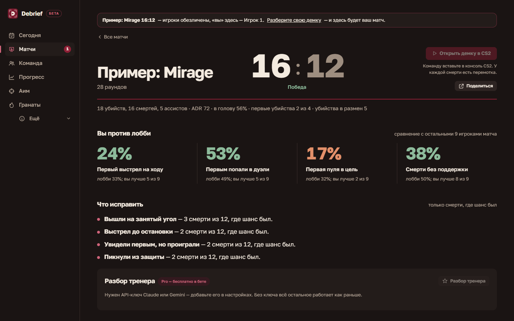
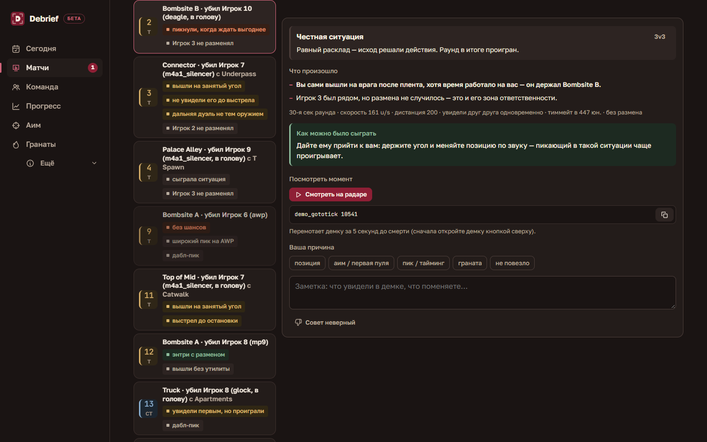
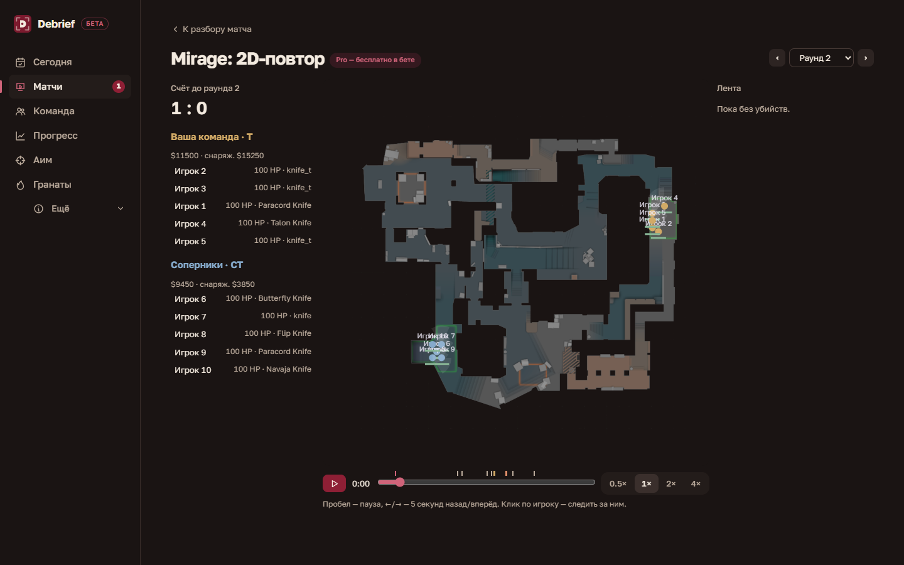

# Debrief

Разбор демок CS2 и план тренировок на вашем ПК. Сейчас — закрытая бета, всё бесплатно.

Debrief сам забирает скачанную демку и разбирает её: почему вы умерли в каждом раунде, где были хуже лобби и что тренировать. Демки обрабатываются локально и никуда не отправляются.

*На скриншотах — встроенный пример, игроки обезличены.*

## Что умеет

- Разбор каждой смерти: ситуация, причина, как можно было сыграть, граната на позицию.
- Сравнение с лобби и 2D-повтор раунда на радаре.
- План тренировок по вашему времени: аим-тренер плюс практика в CS2 под слабые места из демок.
- Раскидки из реальных матчей с кнопкой «Скопировать в консоль».
- Разбор игры пати и FACEIT-матчи.

## Установка

Нужен Windows 10 или 11.

1. Откройте [последний релиз](../../releases) и скачайте `Debrief-Setup-….exe`.
2. Запустите установщик. Права администратора не нужны.
3. Если появится окно SmartScreen «Windows защитила ваш компьютер», нажмите **Подробнее → Выполнить в любом случае**. Окно появляется, потому что у беты пока нет платной подписи кода.

Сверить файл можно по `.sha256` рядом с установщиком. Отчёт VirusTotal — в описании релиза.

Обновления приходят сами: Debrief скачает новую версию и установит её по кнопке «Обновить и перезапустить».

## Обратная связь

Telegram-канал беты: https://t.me/debrief_app

Нашли ошибку — «О программе → Сообщить об ошибке»: Debrief соберёт отчёт без ваших путей, ключей и SteamID, останется его отправить.

## Лицензия

Программа проприетарная, см. [EULA.md](EULA.md). Какие данные куда уходят — [PRIVACY.md](PRIVACY.md). © 2026 Menino's studio. Debrief не связан с Valve и FACEIT и не одобрен ими.
